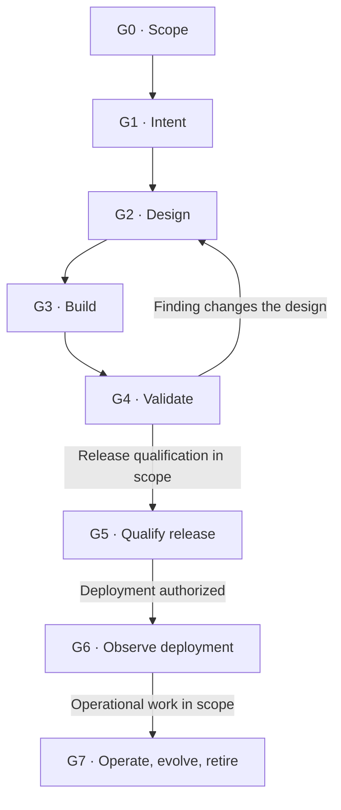
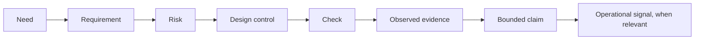

# SDLC assurance

An agent skill for planning, building, reviewing, and validating software with evidence that supports the completion claim.

It addresses a common failure in agent-assisted development: code is written, a few checks pass, and the whole task is declared done. A passing unit suite may leave integration untested. A successful launch may leave the user journey unexercised. A staging result may say nothing about the deployed candidate.

This skill connects requirements and risks to design decisions, meaningful checks, observed results, and an explicitly bounded conclusion. It scales the work to the project, authorized scope, and consequence of failure. It does not certify software or guarantee that defects are absent.

## Install

Requires Node.js and npm. The verified CLI version, `skills@1.7.4`, requires Node.js 22.20.0 or later. Run this from the project where you want the skill installed:

```sh
npx skills install leonardwongly/sdlc-assurance --skill sdlc-assurance
```

For a non-interactive Codex project install:

```sh
npx skills install leonardwongly/sdlc-assurance --skill sdlc-assurance --agent codex --yes
```

Add `--global` if you intentionally want a user-wide install instead. `install` is an alias for the [documented `add` command](https://github.com/vercel-labs/skills/blob/main/docs/commands.md). No npm package from this repository needs to be published; the CLI installs the skill directly from GitHub.

The skill lives at [`skills/sdlc-assurance`](skills/sdlc-assurance). Its entry point is [`SKILL.md`](skills/sdlc-assurance/SKILL.md). Your agent must support loading skills and have the tools and permissions needed for the requested work.

## Use it

Ask your agent to use `sdlc-assurance`, state the desired outcome, and identify relevant limits. For example:

```text
Use $sdlc-assurance to implement tenant-scoped record renaming.
Editors may rename records in their own tenant; viewers and other tenants
must be denied without changing data or emitting a success event.
Validate against the local test database and exercise the connected UI.
Do not deploy. Report the exact evidence and any remaining gaps.
```

Other useful starting points:

- **Review:** “Use $sdlc-assurance to review this migration for data-loss risk. Do not edit or execute it. Separate confirmed findings, assumptions, and proposed tests.”
- **Design:** “Use $sdlc-assurance to redesign our dispatch screen for operators handling urgent cases. Preserve the native platform and design system. Deliver a reviewable prototype and state what remains unvalidated.”
- **Release assessment:** “Use $sdlc-assurance to assess this candidate against our release requirements. Bind results to its artifact and configuration. Identify missing evidence; do not deploy.”
- **Small fix:** “Use $sdlc-assurance to correct this static help-text typo. Keep validation proportional to the actual change.”

The agent first establishes the project context, authorization, acceptance criteria, risk, environment, and intended claim. A review request stays a review; implementation permission does not imply production deployment permission.

## How the workflow works

The gates are decision points. Work can overlap, and new evidence can reopen earlier decisions. A design task can end at G2; an implementation task can end with scoped G3/G4 evidence. Later phases remain explicitly outside scope unless requested.



| Gate | What it asks for |
|---|---|
| **G0 Scope** | Authorized outcome, initial state, unknowns, risk, and intended completion claim |
| **G1 Intent** | Requirements, acceptance examples, invariants, failure risks, and planned verification |
| **G2 Design** | Interfaces, data/state, trust boundaries, recovery, and testability appropriate to those risks |
| **G3 Build** | Implementation, review, and relevant static/component checks |
| **G4 Validate** | Real-boundary and user-journey evidence, plus assurance that the checks are credible |
| **G5 Qualify release** | Candidate-bound evidence, rollout/recovery readiness, monitoring, and risk disposition |
| **G6 Observe deployment** | An authorized rollout actually observed, including artifact/configuration and relevant outcomes |
| **G7 Operate/evolve/retire** | Evidence for monitoring, restoration, incident learning, reassessment, or authorized retirement within a stated scope and interval |

## Context determines the depth

The skill uses three routing tiers, based on consequence and uncertainty rather than diff size:

| Risk | Typical work | Validation approach |
|---|---|---|
| **L — low** | Reversible presentation or documentation change | Inspect the actual result and relevant rendering/build path; avoid unnecessary test scaffolding |
| **M — standard** | Bounded business behavior, data handling, or API change | Trace acceptance and failures to checks; exercise meaningful boundaries and a representative journey |
| **H — high** | Authorization, privacy, payments, destructive migrations, consequential concurrency, or difficult recovery | Add independent challenge, relevant adversarial/recovery checks, and demonstrated detector sensitivity |

Critical or regulated systems also need applicable domain assurance and specialist review. These tiers are not risk probabilities, compliance labels, or instructions to run every available test type.

Project context includes users, domain, maturity, supported platforms, deployment model, data sensitivity, architecture, existing requirements, and tooling constraints. Unknown consequential behavior calls for investigation.

For UI creation or redesign, the skill requires a project-specific design process: understand actual users, content, tasks, states, accessibility needs, and platform constraints; develop an appropriate flow and composition; then inspect and exercise the result.

**Premade page, dashboard, and landing-page templates are excluded.** Native controls, accessible components, design tokens, and purposeful existing conventions can be reused. A narrow repair does not authorize redesigning unrelated screens. See [Custom UI design](skills/sdlc-assurance/references/custom-ui-design.md).

## Evidence and test quality

For consequential requirements, maintain a trace such as:



A useful check specifies its expected result, forbidden effects, correctness oracle, environment, threshold, and evidence before execution. Results need enough provenance to identify the source/artifact, tests, inputs, and execution.

The skill asks the agent to examine the validation itself:

- **Oracle:** Derive expectations from reviewed rules or an independent method, rather than copying production logic.
- **Sensitivity:** Where warranted, show that a relevant check detects a representative defect using a before-fix regression, mutation, negative control, or safe fault injection.
- **Assertions:** Inspect meaningful outputs, persisted changes, events, and prohibited effects.
- **Harness:** Confirm discovery and execution; expose skips, retries, setup failures, isolation, randomness, and cleanup.
- **Fidelity:** State what is mocked and how identity, data, platform, concurrency, permissions, network, or configuration differ from the target.
- **Provenance:** Preserve reviewable raw evidence, with sensitive information appropriately redacted.

Deliberate defect experiments belong in isolated non-production state. Restore and revalidate the clean candidate afterward. High-risk changes require independent challenge of critical oracles and relevant detector sensitivity unless a valid authorized exception is recorded.

Test counts, coverage percentages, mutation scores, reviewer agreement, and green badges cannot replace evidence for the actual requirements and risks. A real violation still matters when an optional check discovers it.

## Reporting without false assurance

Check states are **PASS**, **FAIL**, **BLOCKED**, **NOT_RUN**, and **NOT_APPLICABLE**. Missing credentials or infrastructure means BLOCKED, not NOT_APPLICABLE. A PASS describes only the conditions actually observed.

Gate decisions are **PASS**, **FAIL**, **BLOCKED**, **NOT_READY**, or **CONDITIONAL**. An accepted exception preserves the underlying gap and requires explicit authorization and satisfied conditions; it does not turn missing evidence into PASS. See [Evidence and gates](skills/sdlc-assurance/references/evidence-and-gates.md) for evaluation rules.

Completion language distinguishes **PROPOSED**, **IMPLEMENTED**, **LOCALLY_VERIFIED**, **INTEGRATION_VERIFIED**, **RELEASE_QUALIFIED**, and **DEPLOYED_OBSERVED**. Each claim names the behavior and environment it covers. Changes to a candidate or its assumptions require impact analysis and relevant revalidation.

For example, “implemented; real-database validation blocked” is an honest partial outcome. Mocked tests alone do not establish real-database integration. A verified subset does not complete a larger requested task.

## What is included

- [Skill instructions](skills/sdlc-assurance/SKILL.md) and [lifecycle detail](skills/sdlc-assurance/references/lifecycle.md)
- [Testing and test assurance](skills/sdlc-assurance/references/testing-and-test-assurance.md)
- [Reusable assurance record](skills/sdlc-assurance/assets/assurance-record.md), using only the sections the task needs
- [Worked examples](skills/sdlc-assurance/references/worked-example.md), explicitly illustrative rather than executed results
- [Sources and domain limits](skills/sdlc-assurance/references/sources.md)
- [Interactive visual guide](skills/sdlc-assurance/assets/lifecycle-guide.html)

The visual-guide link opens the HTML source on GitHub, not a live preview. Download or clone the repository and open `skills/sdlc-assurance/assets/lifecycle-guide.html` in a browser. Its stages and controls explain the workflow; they are not live project status or execution evidence.

## Validate this package

From the repository root, run:

```sh
python3 scripts/validate.py
```

CI also runs `skills@1.7.4 install` against the checkout in an isolated project and compares the installed files with the source. Package validation checks the skill distribution. It does not validate a software project that uses the skill or establish any of its release gates.

## What it does not automate

This is a set of instructions and reference materials for an agent. It does not provide a test runner, CI service, security scanner, deployment platform, or monitoring system. It guides use of the tools available in the host environment.

It cannot supply missing infrastructure, credentials, independent domain judgment, or authorization. It does not automatically publish changes, approve exceptions, deploy to production, establish regulatory compliance, or prove that a system is permanently safe. Results depend on actual execution, credible evidence, and the limits reported for the task.

## License

[MIT](LICENSE).
